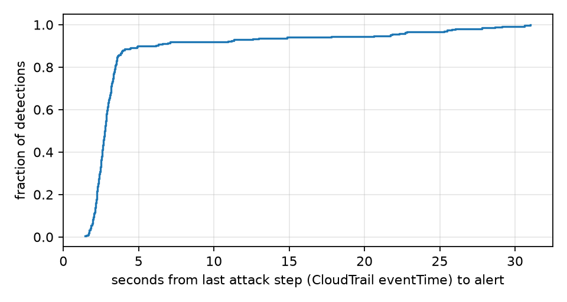
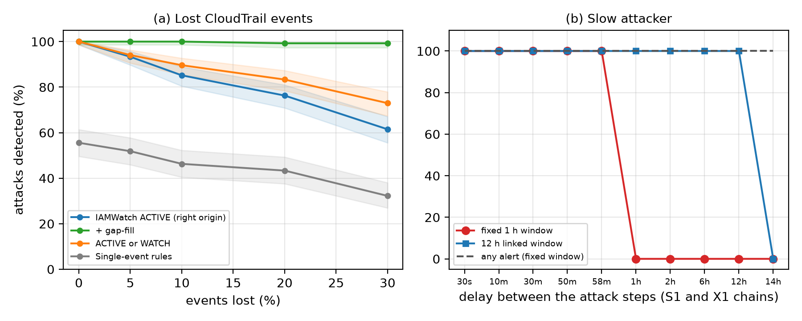

# IAMWatch

**Event-driven detection of multi-step privilege escalation in AWS IAM.**

Attackers rarely jump straight to admin. They climb: assume a role, then another role, then attach a policy. Every step looks harmless on its own, so rules that check one CloudTrail event at a time miss the chain, and periodic scans see it minutes later, after the attacker has finished.

IAMWatch keeps a live map of "who can become whom, and who can reach ADMIN", and checks every IAM action against that map as it happens. When an identity completes a route to admin, it raises an alert that names **who** did it and **the exact path** they took.

## Results at a glance

Tested on a real AWS account with **270 scripted attacks** (9 families × 30 runs) plus one hour of normal activity.

| | IAMWatch | Single-event rules |
|---|---|---|
| Attacks detected (live AWS) | **270 / 270** (95% CI 99–100%) | 150 / 270 |
| Attacks the rules were *not* written for (X1–X4) | **120 / 120** | **0 / 120** |
| Names the origin identity and full path | **Yes** | No |
| False ACTIVE alerts in 1 h of benign activity (213 operations) | **0** | 63 rule hits |
| Median time, last CloudTrail event → stored alert | **2.8 s** (our code: ~0.16 s) | n/a |
| Detection with 30% of events lost, with gap-fill recovery | **99%** | 32% |

Most of the 2.8 s is CloudTrail's own delivery time. The detector itself adds well under a second.



## How it works

```
 AWS action ─► CloudTrail ─► EventBridge ─► SQS FIFO ─► Lambda (IAMWatch engine) ─► DynamoDB / S3 / SNS e-mail
                                                │
                              graph of IAM escalation paths + evidence ledger
```

1. **Attack graph.** Users, roles and groups are nodes, plus one virtual node `ADMIN`. Edges are escalation techniques (AssumeRole, CreateAccessKey, PassRole, policy edits, ...). The engine stores each principal's hop distance to ADMIN (up to 5 hops) and repairs it incrementally when IAM changes, instead of rebuilding the whole graph.
2. **Evidence ledger.** Every event is recorded, and temporary credentials are traced back to the identity that obtained them, so a chain of AssumeRole hops is attributed to the original user.
3. **Ordered path matching.** A path's steps must appear in order inside a 1-hour window (12 hours when steps are linked by an issued credential).
   - Part of a path seen → **WATCH**.
   - All steps seen → **ACTIVE** (alert e-mail).
   - Logging switched off → **EVASION**.
4. **Gap-fill and reconciliation.** A 5-minute job recovers events that never reached the queue, and a 6-hour scan corrects any drift.

It runs only when events arrive (serverless), so it costs cents per month at lab scale.

## Attack families tested

| ID | Technique | Rule-covered |
|---|---|---|
| S1 | AssumeRole into a worker role, then attach AdministratorAccess | yes |
| S2 | CreatePolicyVersion with an admin document | yes |
| S3 | UpdateAssumeRolePolicy on an admin role, then AssumeRole | yes |
| S4 | Pass a privileged role to a new Lambda function | yes |
| S5 | CreateAccessKey for an admin user | yes |
| X1 | Three-hop AssumeRole chain to an admin role | no |
| X2 | AddUserToGroup for an admin group | no |
| X3 | PutUserPolicy on itself | no |
| X4 | SetDefaultPolicyVersion to an old admin version | no |

## Beyond the live run

| Experiment | Finding |
|---|---|
| Noise: attack hidden among up to 1,000 unrelated events | still 100% detected |
| Lost events (5–30%) | 93% → 61% without recovery; ~99% with gap-fill |
| Slow attacker | fixed 1 h window defeated at 1 h; 12 h linked window restores detection up to ~12 h (an attacker who waits longer still only gets WATCH) |
| Two simultaneous attackers | 240 / 240 detected and attributed correctly |
| Periodic scans (5–60 min) vs live | scans lag by a median of 171–1,596 s |
| Incremental update vs full rebuild (400 principals) | 34–125× faster |



## Repository layout

| Path | What is in it |
|---|---|
| `src/iamwatch/` | engine, graph, evidence ledger, baselines, simulator |
| `lambda_src/` | Lambda handler (event processing, gap-fill, reconcile) |
| `infra/` | CloudFormation template |
| `lab/` | lab setup, attack scripts, benign workload |
| `experiments/` | live campaign, simulation, robustness and scaling experiments, analysis |
| `scripts/` | deploy, reset, diagnostics, campaign and offline runners |
| `tests/` | 256 unit and integration tests |
| `results/` | final CSVs, summaries and figures from the experiments |
| `RUNBOOK.md` | step-by-step guide to reproduce everything |

## Quick start

> ⚠️ **Use a dedicated AWS account with no real data.** The lab identities escalate to admin **on purpose**. Never run this in a production account. Never commit credentials: `lab/lab_credentials.json` is git-ignored and must stay private.

```bash
pip install -r requirements.txt
PYTHONPATH=src pytest -q tests                    # 256 tests, no AWS needed
PYTHONPATH=src python experiments/simulate.py     # offline simulation
```

To reproduce the live experiments, follow [`RUNBOOK.md`](RUNBOOK.md): create the lab, deploy the stack, run the campaign (`scripts/campaign.ps1`) and the offline experiments (`scripts/offline_all.ps1`). The whole campaign takes about 3–4 hours.

## Limitations

- Attacks are scripted by the authors and run in a single lab account. 100% means "on these nine known techniques", not "on all attacks".
- The simulator and the engine were written by the same authors, so simulated results show the design works but are not independent evidence.
- Amazon GuardDuty and posture tools (PMapper, Cloudsplaining, IAM Access Analyzer) were not compared.
- The model ignores permission boundaries, session policies, resource policies and organisation policies.
- Event loss in the stress test is random and independent, whereas real loss may be correlated.

## Paper

Accompanying paper: *IAMWatch: Event-Driven, Graph-Based Detection of Multi-Step Privilege Escalation in AWS Identity and Access Management* — [Author names], [venue, year].

## License

All rights reserved
